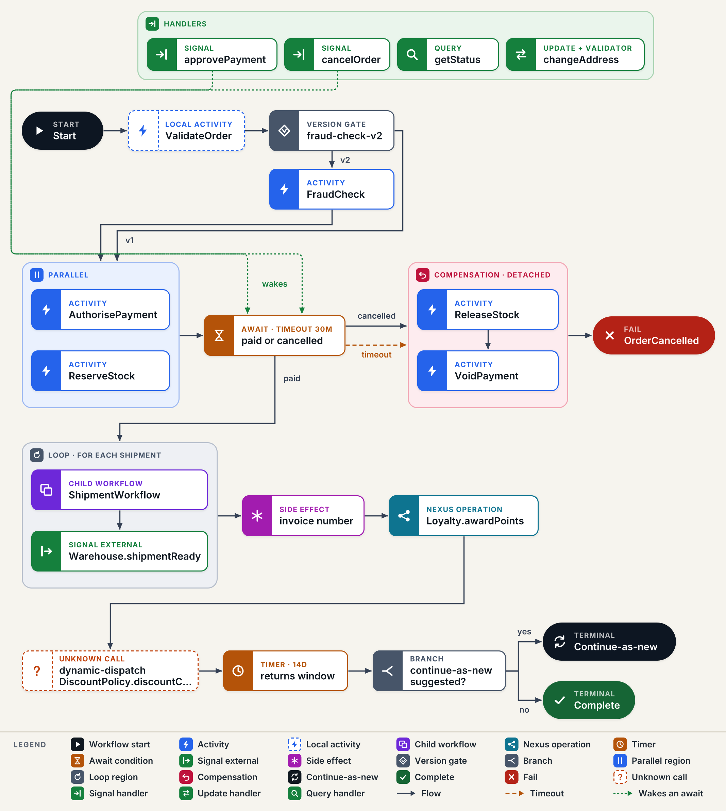
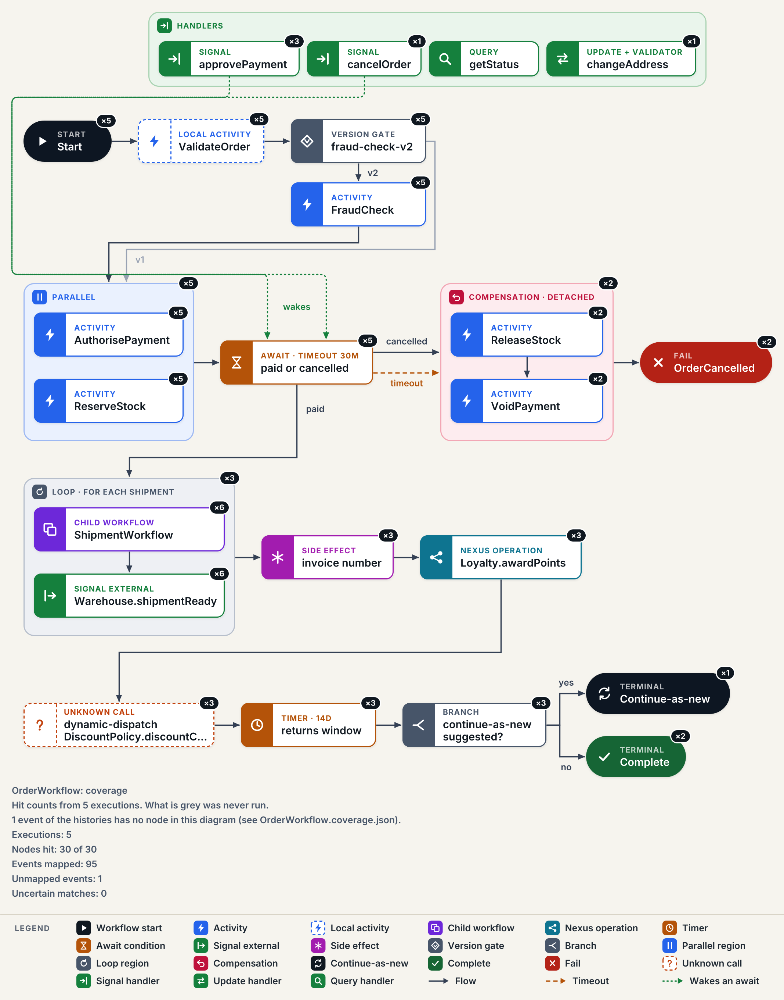
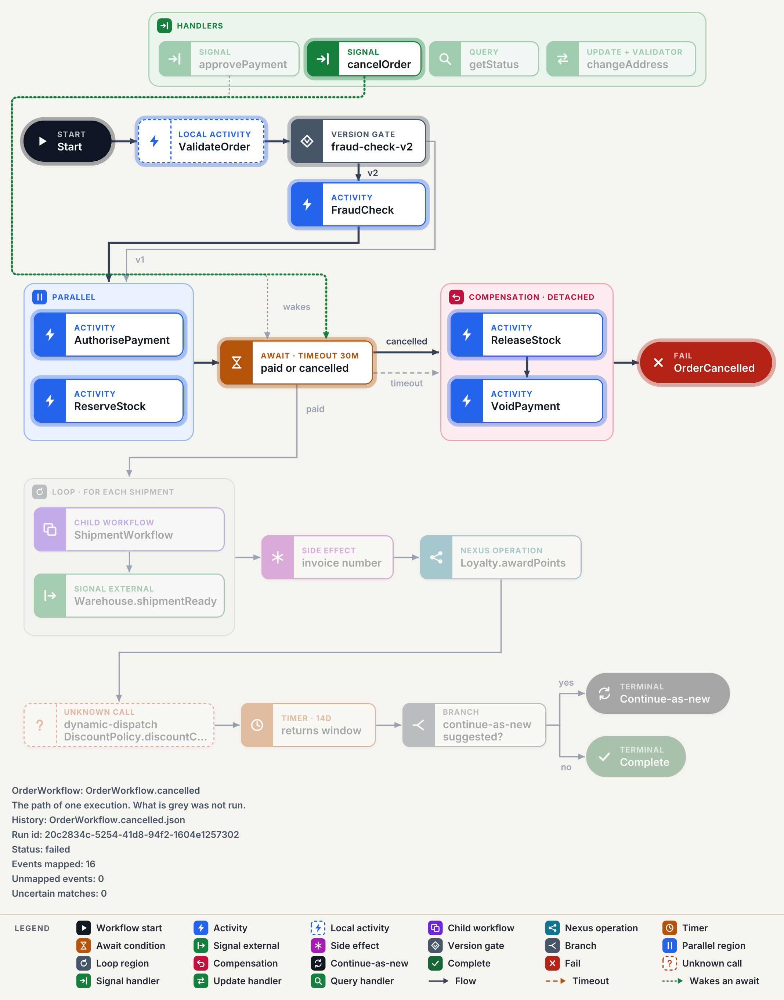

# Durable Atlas

[](https://github.com/iw/durable-atlas/actions/workflows/ci.yml)
[](LICENSE)
[](docs/install.md)
[](gradle/libs.versions.toml)
[](#status)
[](#built-with-claude)

Diagrams of Temporal workflows, read from their Kotlin source.

Durable Atlas reads a repository at a commit, finds every Temporal workflow written in Kotlin,
and draws each one: its activities, child workflows, timers and waits in the order the code
reaches them, the branches, loops, parallel sections and compensations around them, and the
signal, query and update handlers beside them. It runs none of the workflow code. Given the
event histories of real executions, it lays them over the diagrams and shows which paths ran,
how often, and which never did.

It is for people who look after workflows they did not write alone: to review a change, to
explain a workflow to someone new, or to see what production exercises.

Durable Atlas is an independent project, not affiliated with Temporal Technologies, Inc.

```bash
git clone https://github.com/iw/durable-atlas && cd durable-atlas
./gradlew installDist
cli/build/install/durable-atlas/bin/durable-atlas run --repo demo --commit HEAD --out .durable-atlas
```

This builds the tool and draws the workflows of the [demo](demo/README.md), a small
order-processing service. It prints a table of what it drew and the path of an `index.md`
that links it all. Open `OrderWorkflow.svg`, next to that index, in a browser:

<p align="center">
  
</p>

Then lay the demo's five recorded executions over it:

```bash
cli/build/install/durable-atlas/bin/durable-atlas overlay --ir ".durable-atlas/ir/$(git rev-parse HEAD)" \
  --history demo/histories --out .durable-atlas/coverage
```

`.durable-atlas/coverage/OrderWorkflow.coverage.svg` counts how often each step ran, and
`.durable-atlas/coverage/executions/` holds the path of each execution, here the order that
was cancelled while it waited for its payment:

<p align="center">
  
  
</p>

The pictures were drawn with `--wrap-width 1100`, to fit this page; by default a diagram's
rows are 1700 wide. You need a JDK, 17 or later, and git; the first build downloads Gradle
and the tool's dependencies. See [docs/install.md](docs/install.md).

## What it does

- **Finds every workflow of a commit.** Workflow interfaces and the classes that implement
  them, their signal, query and update handlers, and activity interfaces with the activity
  types they register, named by the Temporal Java SDK's own rules. It writes an inventory of
  them, and the list of activity types that no workflow calls.
- **Reads the code and runs none of it.** The sources are resolved with the Kotlin Analysis
  API, which is built on the compiler's own front end. Calls into the repository's own functions are followed,
  eight deep by default, and what they hold is drawn where they are called. The commit is
  read through git; the working tree and the repository are never touched.
- **Draws what a workflow can do.** Activities and local activities, child workflows,
  signals and cancel requests to other workflows, Nexus operations, timers, waits (on a
  condition, a queue, a promise, a lock), side effects, version gates, upserts of search
  attributes and memo, continue-as-new and failures. Around them: branches, loops and
  retries, work started with `Async` and joined with `Promise.allOf` or `anyOf`, saga
  compensations, cancellation scopes, the paths that exceptions and timeouts take, and which
  handler wakes which wait.
- **Says what it cannot tell.** A step chosen at run time, a call too deep to follow or code
  that is not there to read is an `unknown` node with its reason and its place in the
  source. A guess is never drawn as a fact. By default a diagram is an overview: a call
  behind which a step is only possible is left out and listed, and `--detail full` draws
  every one. See [docs/decisions.md](docs/decisions.md).
- **Writes SVG, Mermaid and HTML.** An SVG diagram is one self-contained file without
  script: a card per step with its own icon and colour, regions as boxes, handlers in a
  band above the flow, a legend, and links to the diagrams of child workflows and, if you
  say where the code is hosted, to source lines. The Mermaid diagram of the same workflow is
  a Markdown page that Git hosts draw in place. `--html` adds a page per workflow, and an
  index links everything.
- **Lays real executions over the diagrams.** `fetch` downloads recent event histories of a
  workflow type from a Temporal server; `overlay` walks each history through the graph. The
  coverage diagram puts a hit count on every step and greys what never ran; each execution
  gets a diagram of its own path. Events that fit no node are listed, with the `unknown`
  call they may lie behind. A version map lays each history over the commit its worker was
  built from.
- **Works without the build.** By default the repository's own Gradle build says which
  modules and classpaths there are. Where that build cannot run, or should not, degraded
  mode reads the commit with git alone and resolves it against the Temporal SDK that
  travels with the tool. Calls into other libraries are then left out and listed, not
  guessed. See [docs/usage.md](docs/usage.md#gradle-mode-and-degraded-mode).
- **Keeps a documented IR between analysis and drawing.** Each workflow is a JSON document
  with a schema: flat lists of nodes and edges, regions by parent, ids that stay the same
  while the code does. The renderers and the overlay read nothing else, so you can keep the
  IR of a commit, compare two, or draw documents made elsewhere. See
  [docs/ir.md](docs/ir.md).
- **Is deterministic.** The same commit and options give the same bytes, in the IR and in
  every diagram, on any machine: text is measured with the typeface the tool brings.
- **Keeps large workflows drawable.** The main flow wraps into rows; a workflow over a node
  limit has its regions drawn as single nodes; every SVG diagram has a time limit, and one
  that misses it is drawn more simply and says so. Progress goes to stderr, results to
  stdout.

## Commands

```text
durable-atlas run     --repo DIR --commit REV --out DIR [--mode gradle|degraded] [--force]
                      [--max-depth N] [--detail overview|full] [--max-unresolved-pct N]
                      [--jdk-home DIR] [diagram options]
durable-atlas model   --repo DIR --commit REV --out DIR [--mode gradle|degraded] [--force] [--keep-scratch]
durable-atlas analyse --model DIR --out DIR [--workflow TYPE] [--max-depth N] [--detail overview|full]
                      [--max-unresolved-pct N] [--jdk-home DIR]
durable-atlas render  --ir DIR --out DIR [diagram options]
durable-atlas fetch   --workflow-type TYPE --limit N --out DIR [--since TIME] [--until TIME]
                      [--address HOST:PORT] [--namespace NAME] [--api-key KEY] [--tls | --no-tls] [--profile NAME] …
durable-atlas overlay --ir DIR --history FILE|DIR --out DIR [--version-map FILE] [--max-unmapped-pct N]
                      [diagram options]

diagram options:      [--format svg|mermaid|all] [--html] [--max-nodes N] [--wrap-width N]
                      [--legend present|full|none] [--source-base-url URL] [--background paper|transparent]
                      [--embed-font] [--svg-timeout SECONDS]
```

`run` is `model`, `analyse` and `render` in turn. Every command takes `--json` for a
machine-readable summary, and `--help`. Exit status 0 is success, 1 a failure, 2 a limit
that was exceeded, 3 a run that fell back to degraded mode.
[docs/usage.md](docs/usage.md) explains every option and the files each command writes.

## Modules

| Module | Responsibility |
| --- | --- |
| `ir` | The workflow IR: types, JSON form, schema, canonical order, validation |
| `model-extractor` | The model of a commit: reads the repository through git, asks its Gradle build for modules and classpaths, or builds a degraded model |
| `analyser` | From model to IR: the Kotlin Analysis API backend in a class loader of its own, discovery of workflows and activities, the flow and the graph of each entry point |
| `render` | From IR to diagrams: Mermaid, SVG (laid out with the Eclipse Layout Kernel), HTML pages, the index, the time limit |
| `overlay` | From IR and event histories to coverage: reading and fetching histories, mapping events to nodes, overlay diagrams, the version map |
| `cli` | The `durable-atlas` command: options, summaries, progress and exit statuses |
| `build-logic` | The convention plugins the modules share |

`demo/` holds the [demo](demo/README.md): an order workflow that uses most of what a
workflow can do, once each, with the IR expected for it and five recorded histories.
`fixtures/sample-monorepo/` is a larger sample repository, one workflow per construct, that
the tests analyse. Both are Gradle builds of their own.

## Documentation

- [Usage](docs/usage.md): every command and option, the output directory, exit statuses,
  Gradle mode and degraded mode, overlays, the time limit.
- [Installing and building](docs/install.md): the JDK, building, and building where the
  public repositories cannot be reached.
- [The workflow IR](docs/ir.md): documents, node and edge kinds, regions and implied edges,
  with the demo's IR as the worked example.
- [Architecture](docs/architecture.md): the modules, the pipeline from repository to
  diagram, and where each decision lives.
- [Decisions and known limitations](docs/decisions.md): what is drawn and why.
- [The demo](demo/README.md): from each line of `OrderWorkflow` to its diagram element.
- [Contributing](CONTRIBUTING.md) and the [security policy](SECURITY.md).
- [AGENTS.md](AGENTS.md): guidance for coding agents working in this repository.

## Testing

```bash
./gradlew build
```

runs some 3,500 tests. The suite covers:

- the IR: its schema, its canonical form, validation, and the demo's document;
- model extraction from the sample repository, through its Gradle build and without it;
- the analysis of Kotlin sources written for each construct, against the IR expected for
  them, in both modes, and of the demo against its hand-written IR;
- the overview of every one of those sources against its full detail: the same steps with
  the same ids, no way between two steps that the full detail lacks, and every call that
  was left out listed;
- the SDK's naming rules, activity options, fail types and Kotlin extensions;
- both renderers on every document: Mermaid text that parses, golden files compared byte
  for byte, the structure of the SVG, where labels lie, how edges are routed, rows and
  the node limit;
- the time limit, by counting work, never time;
- overlays of the sample repository's and the demo's recorded histories, coverage, the
  version map, and `fetch` against a stand-in for a Temporal server;
- every command, its summaries and exit statuses, and the installed tool started as a
  user starts it.

The sample repository has tests of its own, which run its workflows in the SDK's
time-skipping test environment and check the histories the overlay tests use:

```bash
cd fixtures/sample-monorepo && ./gradlew build
```

One test fetches from a real Temporal server and is no part of the build:

```bash
./gradlew :cli:serverTest -Ddurable-atlas.server=127.0.0.1:7233
```

Its KDoc, in `ServerFetchOverlayTest`, says what the server has to hold.

## Requirements

- A JDK, 17 or later. The tool is built and tested on JDK 17 and JDK 25; its class files
  are made for Java 17.
- git.
- Network access for the first build, which fetches Gradle 9.9.1, Kotlin 2.4.21, the Kotlin
  Analysis API and the Temporal Java SDK 1.41.1 with the other dependencies.
  [docs/install.md](docs/install.md) says how to build from a repository manager instead.

## Security

In Gradle mode, which is the default, Durable Atlas starts the Gradle build of the
repository it analyses. That runs the repository's wrapper, build scripts and plugins with
your rights: point the tool only at code you would build yourself, or use
`--mode degraded`, which runs none of it. Event histories that `fetch` writes hold the
payloads of your workflows. To report a vulnerability, and for what the tool reads, writes
and sends, see [SECURITY.md](SECURITY.md).

## Status

Durable Atlas draws workflows written in **Kotlin** against the blocking `Workflow` API of
the **Temporal Java SDK**, and is written and tested against SDK **1.41.1** and Kotlin
**2.4.21**. It reads repositories built with Gradle, or any repository in degraded mode. It
is built and tested on JDK 17 and JDK 25; CI does so on Linux.

Not supported yet: workflows written in Java, which are listed in the inventory and not
drawn. There is no release: you build the tool from source, and its command line, IR and
file layout can still change. Known limitations, and the decisions behind what is drawn,
are in [docs/decisions.md](docs/decisions.md).

## Related projects

Durable Atlas shows what a workflow's code can do. Two sister projects look at the
cluster that runs it:

- [Durable Envision](https://github.com/iw/durable-envision), a discrete-event simulator that
  surfaces hotspots in Temporal Server clusters on EKS before they show up in production.
- [Durable Inquiry](https://github.com/iw/durable-inquiry), evidence-driven diagnostics
  that find out why a running Temporal deployment is misbehaving.

## Built with Claude

Durable Atlas was built by [Claude](https://www.anthropic.com/claude), the AI model made by
[Anthropic](https://www.anthropic.com), working through
[Claude Code](https://claude.com/claude-code). Claude wrote the Kotlin, read the Temporal
Java SDK's sources for the rules the analysis follows, and wrote the tests, the demo and
the documentation. The maintainer directs the work, reviews every change, and decides what
is committed.

Every commit credits Claude with a `Co-Authored-By` trailer that names the model, as
[AGENTS.md](AGENTS.md) sets out. [CLAUDE.md](CLAUDE.md) adds the notes that are Claude's
alone.

## Licence

Durable Atlas is licensed under the [Apache License, Version 2.0](LICENSE). A built
distribution bundles other projects' libraries, and an SVG diagram written with
`--embed-font` carries the Inter typeface; [THIRD_PARTY_NOTICES.md](THIRD_PARTY_NOTICES.md)
names them and their licences.
