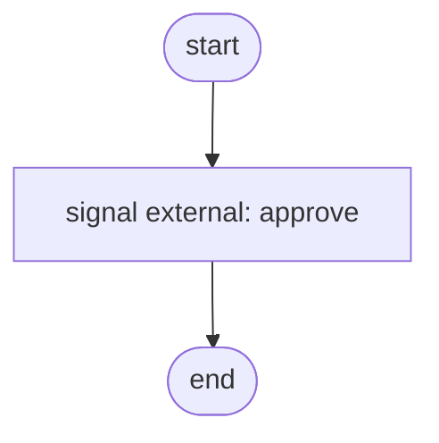

# SignalExternalWorkflow

[All workflows](index.md)

| Property | Value |
|---|---|
| Workflow type | `SignalExternalWorkflow` |
| Interface | `com.example.fixture.workflows.primitives.SignalExternalWorkflow` |
| Implementation | `com.example.fixture.workflows.primitives.SignalExternalWorkflowImpl` |
| Module | `:workflows` |
| Commit | `0000000000000000000000000000000000000000` |
| Model mode | gradle |
| Nodes | 3 |
| Unknown nodes | 0 |

