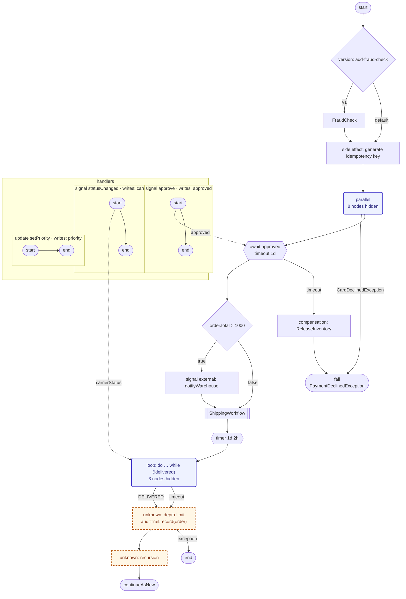

# FulfilmentWorkflow

> **Note:** This workflow has 34 nodes, more than the limit of 10, so its 2 regions are drawn as single nodes (23 nodes shown). Regions are loops, parallel sections and compensations.

| Property | Value |
|---|---|
| Workflow type | `FulfilmentWorkflow` |
| Interface | `com.example.fulfilment.FulfilmentWorkflow` |
| Implementation | `com.example.fulfilment.FulfilmentWorkflowImpl` |
| Module | `:fulfilment` |
| Commit | `3f786850e387550fdab836ed7e6dc881de23001b` |
| Model mode | gradle |
| Nodes | 34 |
| Unknown nodes | 2 |

## Child workflows

- `ShippingWorkflow`: no diagram

## Unknown nodes

- `depth-limit`: `auditTrail.record(order)` at `fulfilment/src/main/kotlin/com/example/fulfilment/FulfilmentWorkflowImpl.kt:66`
- `recursion` at `fulfilment/src/main/kotlin/com/example/fulfilment/FulfilmentWorkflowImpl.kt:67`
