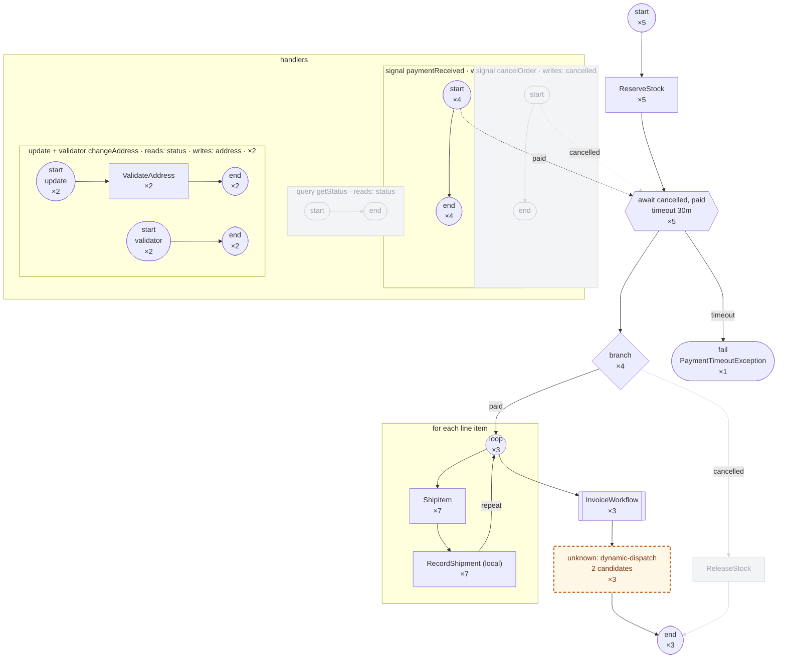

# OrderWorkflow: coverage

[All workflows](index.md)

> Hit counts from 5 executions; \*grey\* was never reached.

| Property | Value |
|---|---|
| Workflow type | `OrderWorkflow` |
| Interface | `com.example.orders.OrderWorkflow` |
| Implementation | `com.example.orders.OrderWorkflowImpl` |
| Module | `:orders:workflows` |
| Commit | `3f786850e387550fdab836ed7e6dc881de23001b` |
| Model mode | gradle |
| Nodes | 23 |
| Unknown nodes | 1 |
| Executions | 5 |
| Unmapped events | 0 |

## Child workflows

- `InvoiceWorkflow`: no diagram

## Unknown nodes

- `dynamic-dispatch` at `orders/workflows/src/main/kotlin/com/example/orders/OrderWorkflowImpl.kt:61`; candidates: `com.example.orders.EmailNotifier`, `com.example.orders.SmsNotifier`
