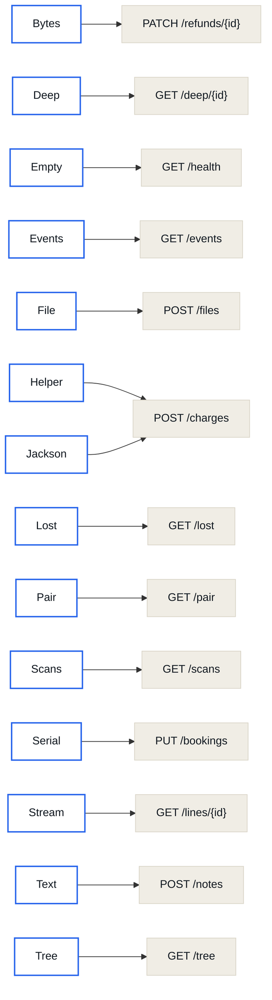
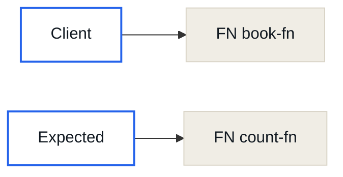

# Endpoints

[All workflows](../index.md)

Every service operation the activities call, what it sends and gets back, and the workflows that depend on it, as the code of commit `0000000000000000000000000000000000000000` shows them. Each service is also an OpenAPI 3.1 document next to this page: [billing.openapi.json](billing.openapi.json) · [ServiceClient.openapi.json](ServiceClient.openapi.json).

| Services | Operations | Calls | Models | Workflows |
|---:|---:|---:|---:|---:|
| 2 | 15 | 16 | 17 | 1 |

## Who calls what

Each workflow and the services its activities call, with how many of each service's operations it reaches.

| Workflow | Services |
|---|---|
| [Paying](../Paying.md) | [`billing`](#service-billing) (2) |
| no workflow | [`billing`](#service-billing) (12) · [`ServiceClient`](#service-serviceclient) (2) |

## Activities

Each activity type that calls another service, and the operations it calls in the order of its code.

### Activity Bytes

Interface `payloads.Payloads`. Workflows: none of these sources.

- [`PATCH billing /refunds/{id}`](#patch-billing-refundsid)

### Activity Client

Interface `payloads.Payloads`. Workflows: none of these sources.

- [`FN book-fn`](#fn-book-fn)

### Activity Deep

Interface `payloads.Payloads`. Workflows: none of these sources.

- [`GET billing /deep/{id}`](#get-billing-deepid)

### Activity Empty

Interface `payloads.Payloads`. Workflows: none of these sources.

- [`GET billing /health`](#get-billing-health)

### Activity Events

Interface `payloads.Payloads`. Workflows: none of these sources.

- [`GET billing /events`](#get-billing-events)

### Activity Expected

Interface `payloads.Payloads`. Workflows: none of these sources.

- [`FN count-fn`](#fn-count-fn)

### Activity File

Interface `payloads.Payloads`. Workflows: none of these sources.

- [`POST billing /files`](#post-billing-files)

### Activity Helper

Interface `payloads.Payloads`. Workflows: none of these sources.

- [`POST billing /charges`](#post-billing-charges)

### Activity Jackson

Interface `payloads.Payloads`. Workflows: [Paying](../Paying.md).

- [`POST billing /charges`](#post-billing-charges)

### Activity Lost

Interface `payloads.Payloads`. Workflows: none of these sources.

- [`GET billing /lost`](#get-billing-lost)

### Activity Pair

Interface `payloads.Payloads`. Workflows: none of these sources.

- [`GET billing /pair`](#get-billing-pair)

### Activity Scans

Interface `payloads.Payloads`. Workflows: none of these sources.

- [`GET billing /scans`](#get-billing-scans)

### Activity Serial

Interface `payloads.Payloads`. Workflows: [Paying](../Paying.md).

- [`PUT billing /bookings`](#put-billing-bookings)

### Activity Stream

Interface `payloads.Payloads`. Workflows: none of these sources.

- [`GET billing /lines/{id}`](#get-billing-linesid)

### Activity Text

Interface `payloads.Payloads`. Workflows: none of these sources.

- [`POST billing /notes`](#post-billing-notes)

### Activity Tree

Interface `payloads.Payloads`. Workflows: none of these sources.

- [`GET billing /tree`](#get-billing-tree)

## Service billing

HTTP service with 13 operations. OpenAPI: [billing.openapi.json](billing.openapi.json).

Servers:

- `http://billing.example.com` from `billing.url` in `app/src/main/resources/application.yaml`
- `https://billing.prod.example.com` from `billing.url` in `app/src/main/resources/application.yaml`, profile `prod`

### PUT billing /bookings

Path: `/bookings`

**Request:** `Booking` ([Booking](#model-payloadsbooking)) (application/json, kotlinx.serialization)

| Field | Type | Optional | Kotlin |
|---|---|---|---|
| `booking_id` | `String` |  | `id` |
| `level` | `Level` ([Level](#model-payloadslevel)) | optional |  |

**Response:** `Booking` ([Booking](#model-payloadsbooking)) (kotlinx.serialization)

| Field | Type | Optional | Kotlin |
|---|---|---|---|
| `booking_id` | `String` |  | `id` |
| `level` | `Level` ([Level](#model-payloadslevel)) | optional |  |

Called by:

- [`Serial`](#activity-serial) in [Paying](../Paying.md), `app/src/main/kotlin/payloads/Payloads.kt:94`

### POST billing /charges

Path: `/charges`

**Request:** `Charge` ([Charge](#model-payloadscharge)) (Jackson)

| Field | Type | Optional | Kotlin |
|---|---|---|---|
| `orderId` | `String` |  |  |
| `total` | `Money` ([Money](#model-payloadsmoney)) |  | `amount` |
| `method` | `Method` ([Method](#model-payloadsmethod)) |  |  |
| `key` | `UUID?` | optional |  |
| `note` | `String?` | optional |  |

**Response:** `Receipt` ([Receipt](#model-payloadsreceipt)) (Jackson)

| Field | Type | Optional | Kotlin |
|---|---|---|---|
| `charge-id` | `String` |  | `chargeId` |
| `taken-at` | `Instant` |  | `takenAt` |
| `lines` | `List<Line>` ([Line](#model-payloadsline)) |  |  |
| `totals` | `Map<String, Money>` ([Money](#model-payloadsmoney)) |  |  |

Called by:

- [`Helper`](#activity-helper) in no workflow of these sources, `app/src/main/kotlin/payloads/Payloads.kt:119`
- [`Jackson`](#activity-jackson) in [Paying](../Paying.md), `app/src/main/kotlin/payloads/Payloads.kt:75`

### GET billing /deep/{id}

Path: `/deep/{id}`

| Parameter | In | Type | Value |
|---|---|---|---|
| `id` | path | `String` |  |

**Request:** no body. The request sends no body.

**Response:** `Receipt` ([Receipt](#model-payloadsreceipt)) (Jackson)

| Field | Type | Optional | Kotlin |
|---|---|---|---|
| `charge-id` | `String` |  | `chargeId` |
| `taken-at` | `Instant` |  | `takenAt` |
| `lines` | `List<Line>` ([Line](#model-payloadsline)) |  |  |
| `totals` | `Map<String, Money>` ([Money](#model-payloadsmoney)) |  |  |

Called by:

- [`Deep`](#activity-deep) in no workflow of these sources, `app/src/main/kotlin/payloads/Payloads.kt:164`

### GET billing /events

Path: `/events`

**Request:** no body. The request sends no body.

**Response:** `List<Event>` ([Event](#model-payloadsevent)) (Jackson)

One of, told apart by `kind`:

- `placed`: `Placed` ([Placed](#model-payloadseventplaced))
- `dropped`: `Dropped` ([Dropped](#model-payloadseventdropped))

Called by:

- [`Events`](#activity-events) in no workflow of these sources, `app/src/main/kotlin/payloads/Payloads.kt:144`

### POST billing /files

Path: `/files`

**Request:** unknown. A body is sent, but where it comes from could not be followed.

**Response:** not read. The code does not read the answer: it is discarded, or its body is never asked for.

Called by:

- [`File`](#activity-file) in no workflow of these sources, `app/src/main/kotlin/payloads/Payloads.kt:139`

### GET billing /health

Path: `/health`

**Request:** no body. The request sends no body.

**Response:** text. The code keeps the answer as text and does not convert it.

Called by:

- [`Empty`](#activity-empty) in no workflow of these sources, `app/src/main/kotlin/payloads/Payloads.kt:107`

### GET billing /lines/{id}

Path: `/lines/{id}`

| Parameter | In | Type | Value |
|---|---|---|---|
| `id` | path | `String` |  |
| `page` | query | `Int` | `{page}` |

**Request:** no body. The request sends no body.

**Response:** `Page<Line>` ([Line](#model-payloadsline), [Page](#model-payloadspage)) (Jackson)

| Field | Type | Optional | Kotlin |
|---|---|---|---|
| `items` | `List<Line>` ([Line](#model-payloadsline)) |  |  |
| `next` | `String?` |  |  |

Called by:

- [`Stream`](#activity-stream) in no workflow of these sources, `app/src/main/kotlin/payloads/Payloads.kt:124`

### GET billing /lost

Path: `/lost`

**Request:** no body. The request sends no body.

**Response:** unknown. What the code makes of the answer could not be followed.

Called by:

- [`Lost`](#activity-lost) in no workflow of these sources, `app/src/main/kotlin/payloads/Payloads.kt:130`

### POST billing /notes

Path: `/notes`

**Request:** text (text/plain). The code puts the body together as text; its structure is not read.

**Response:** not read. The code does not read the answer: it is discarded, or its body is never asked for.

Called by:

- [`Text`](#activity-text) in no workflow of these sources, `app/src/main/kotlin/payloads/Payloads.kt:102`

### GET billing /pair

Path: `/pair`

**Request:** no body. The request sends no body.

**Response:** `Pair<String, Int>` ([Pair](#model-kotlinpair)) (Jackson)

| Field | Type | Optional | Kotlin |
|---|---|---|---|
| `first` | `String` |  |  |
| `second` | `Int` |  |  |

Called by:

- [`Pair`](#activity-pair) in no workflow of these sources, `app/src/main/kotlin/payloads/Payloads.kt:159`

### PATCH billing /refunds/{id}

Path: `/refunds/{id}`

| Parameter | In | Type | Value |
|---|---|---|---|
| `id` | path | `String` |  |

**Request:** `List<Line>` ([Line](#model-payloadsline)) (application/json, Jackson)

| Field | Type | Optional | Kotlin |
|---|---|---|---|
| `sku` | `String` |  |  |
| `quantity` | `Int` |  |  |

**Response:** `List<Line>` ([Line](#model-payloadsline)) (Jackson)

| Field | Type | Optional | Kotlin |
|---|---|---|---|
| `sku` | `String` |  |  |
| `quantity` | `Int` |  |  |

Called by:

- [`Bytes`](#activity-bytes) in no workflow of these sources, `app/src/main/kotlin/payloads/Payloads.kt:84`

### GET billing /scans

Path: `/scans`

**Request:** no body. The request sends no body.

**Response:** `Scan` ([Scan](#model-payloadsscan)) (kotlinx.serialization)

One of, told apart by `type`:

- `seen`: `Seen` ([Seen](#model-payloadsscanseen))
- `gone`: `Gone` ([Gone](#model-payloadsscangone))

Called by:

- [`Scans`](#activity-scans) in no workflow of these sources, `app/src/main/kotlin/payloads/Payloads.kt:149`

### GET billing /tree

Path: `/tree`

**Request:** no body. The request sends no body.

**Response:** `Node` ([Node](#model-payloadsnode)) (Jackson)

| Field | Type | Optional | Kotlin |
|---|---|---|---|
| `name` | `String` |  |  |
| `parent` | `Node?` ([Node](#model-payloadsnode)) |  |  |
| `children` | `List<Node>` ([Node](#model-payloadsnode)) |  |  |

Called by:

- [`Tree`](#activity-tree) in no workflow of these sources, `app/src/main/kotlin/payloads/Payloads.kt:154`

## Service ServiceClient

Client with 2 operations. OpenAPI: [ServiceClient.openapi.json](ServiceClient.openapi.json).

Called as `ServiceClient.invoke(…)`, one operation per name it is asked for.

### FN book-fn

Signature: `book-fn(payload: Charge) → Booking`

Operation name from `payloads.PayloadsImpl.BOOK`.

**Argument `payload`:** `Charge` ([Charge](#model-payloadscharge))

| Field | Type | Optional | Kotlin |
|---|---|---|---|
| `orderId` | `String` |  |  |
| `total` | `Money` ([Money](#model-payloadsmoney)) |  | `amount` |
| `method` | `Method` ([Method](#model-payloadsmethod)) |  |  |
| `key` | `UUID?` | optional |  |
| `note` | `String?` | optional |  |

**Returns:** `Booking` ([Booking](#model-payloadsbooking))

| Field | Type | Optional | Kotlin |
|---|---|---|---|
| `booking_id` | `String` |  | `id` |
| `level` | `Level` ([Level](#model-payloadslevel)) | optional |  |

Called by:

- [`Client`](#activity-client) in no workflow of these sources, `app/src/main/kotlin/payloads/Payloads.kt:173`

### FN count-fn

Signature: `count-fn(payload: String) → Int`

**Argument `payload`:** `String`

**Returns:** `Int`

Called by:

- [`Expected`](#activity-expected) in no workflow of these sources, `app/src/main/kotlin/payloads/Payloads.kt:176`

## Models

Every type a request sends or reads its answer as, and the types those reach, with the names the library writes.

### Model kotlin.Pair

Object `kotlin.Pair<A, B>`.

| Field | Type | Optional | Kotlin |
|---|---|---|---|
| `first` | `A` |  |  |
| `second` | `B` |  |  |

- read from [`GET billing /pair`](#get-billing-pair)

### Model org.example.rates.Rate

Not read `org.example.rates.Rate`.

Its source is not in the model, so its fields are not known.

- part of [`Money`](#model-payloadsmoney)

### Model payloads.Booking

Object `payloads.Booking`, declared at `app/src/main/kotlin/payloads/Serial.kt:8`.

| Field | Type | Optional | Kotlin |
|---|---|---|---|
| `booking_id` | `String` |  | `id` |
| `level` | `Level` ([Level](#model-payloadslevel)) | optional |  |

- sent by [`PUT billing /bookings`](#put-billing-bookings)
- read from [`PUT billing /bookings`](#put-billing-bookings)
- read from [`FN book-fn`](#fn-book-fn)

### Model payloads.Charge

Object `payloads.Charge`, declared at `app/src/main/kotlin/payloads/Models.kt:17`.

| Field | Type | Optional | Kotlin |
|---|---|---|---|
| `orderId` | `String` |  |  |
| `total` | `Money` ([Money](#model-payloadsmoney)) |  | `amount` |
| `method` | `Method` ([Method](#model-payloadsmethod)) |  |  |
| `key` | `UUID?` | optional |  |
| `note` | `String?` | optional |  |

- sent by [`POST billing /charges`](#post-billing-charges)
- sent by [`FN book-fn`](#fn-book-fn)

### Model payloads.Event

One of several types `payloads.Event`, declared at `app/src/main/kotlin/payloads/Models.kt:41`.

One of, told apart by `kind`:

- `placed`: `Placed` ([Placed](#model-payloadseventplaced))
- `dropped`: `Dropped` ([Dropped](#model-payloadseventdropped))

- read from [`GET billing /events`](#get-billing-events)

### Model payloads.Event.Dropped

Object `payloads.Event.Dropped`, declared at `app/src/main/kotlin/payloads/Models.kt:44`.

| Field | Type | Optional | Kotlin |
|---|---|---|---|
| `reason` | `String?` |  |  |

- part of [`Event`](#model-payloadsevent)

### Model payloads.Event.Placed

Object `payloads.Event.Placed`, declared at `app/src/main/kotlin/payloads/Models.kt:42`.

| Field | Type | Optional | Kotlin |
|---|---|---|---|
| `at` | `Instant` |  |  |

- part of [`Event`](#model-payloadsevent)

### Model payloads.Level

Enum `payloads.Level`, declared at `app/src/main/kotlin/payloads/Serial.kt:11`.

Values: `standard`, `express`

- part of [`Booking`](#model-payloadsbooking)

### Model payloads.Line

Object `payloads.Line`, declared at `app/src/main/kotlin/payloads/Models.kt:32`.

| Field | Type | Optional | Kotlin |
|---|---|---|---|
| `sku` | `String` |  |  |
| `quantity` | `Int` |  |  |

- sent by [`PATCH billing /refunds/{id}`](#patch-billing-refundsid)
- read from [`GET billing /lines/{id}`](#get-billing-linesid)
- read from [`PATCH billing /refunds/{id}`](#patch-billing-refundsid)
- part of [`Receipt`](#model-payloadsreceipt)

### Model payloads.Method

Enum `payloads.Method`, declared at `app/src/main/kotlin/payloads/Models.kt:15`.

Values: `CARD`, `bank-transfer`

- part of [`Charge`](#model-payloadscharge)

### Model payloads.Money

Object `payloads.Money`, declared at `app/src/main/kotlin/payloads/Models.kt:13`.

| Field | Type | Optional | Kotlin |
|---|---|---|---|
| `cents` | `Long` |  |  |
| `currency` | `String` | optional |  |
| `rate` | `Rate?` ([Rate](#model-orgexampleratesrate)) | optional |  |

- part of [`Charge`](#model-payloadscharge), [`Receipt`](#model-payloadsreceipt)

### Model payloads.Node

Object `payloads.Node`, declared at `app/src/main/kotlin/payloads/Models.kt:47`.

| Field | Type | Optional | Kotlin |
|---|---|---|---|
| `name` | `String` |  |  |
| `parent` | `Node?` ([Node](#model-payloadsnode)) |  |  |
| `children` | `List<Node>` ([Node](#model-payloadsnode)) |  |  |

- read from [`GET billing /tree`](#get-billing-tree)

### Model payloads.Page

Object `payloads.Page<T>`, declared at `app/src/main/kotlin/payloads/Models.kt:34`.

| Field | Type | Optional | Kotlin |
|---|---|---|---|
| `items` | `List<T>` |  |  |
| `next` | `String?` |  |  |

- read from [`GET billing /lines/{id}`](#get-billing-linesid)

### Model payloads.Receipt

Object `payloads.Receipt`, declared at `app/src/main/kotlin/payloads/Models.kt:30`.

| Field | Type | Optional | Kotlin |
|---|---|---|---|
| `charge-id` | `String` |  | `chargeId` |
| `taken-at` | `Instant` |  | `takenAt` |
| `lines` | `List<Line>` ([Line](#model-payloadsline)) |  |  |
| `totals` | `Map<String, Money>` ([Money](#model-payloadsmoney)) |  |  |

- read from [`POST billing /charges`](#post-billing-charges)
- read from [`GET billing /deep/{id}`](#get-billing-deepid)

### Model payloads.Scan

One of several types `payloads.Scan`, declared at `app/src/main/kotlin/payloads/Serial.kt:14`.

One of, told apart by `type`:

- `seen`: `Seen` ([Seen](#model-payloadsscanseen))
- `gone`: `Gone` ([Gone](#model-payloadsscangone))

- read from [`GET billing /scans`](#get-billing-scans)

### Model payloads.Scan.Gone

Object `payloads.Scan.Gone`, declared at `app/src/main/kotlin/payloads/Serial.kt:21`.

| Field | Type | Optional | Kotlin |
|---|---|---|---|
| `at` | `String` |  |  |

- part of [`Scan`](#model-payloadsscan)

### Model payloads.Scan.Seen

Object `payloads.Scan.Seen`, declared at `app/src/main/kotlin/payloads/Serial.kt:17`.

| Field | Type | Optional | Kotlin |
|---|---|---|---|
| `at` | `String` |  |  |

- part of [`Scan`](#model-payloadsscan)
