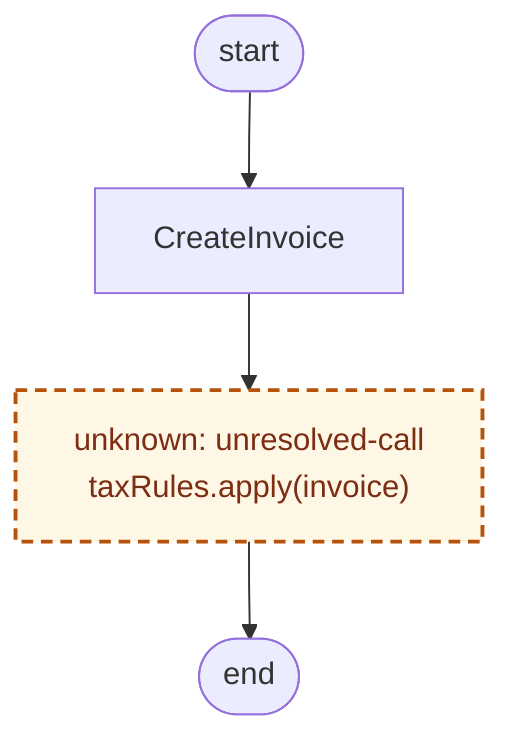

# InvoiceWorkflow

[All workflows](index.md)

> **Warning:** this diagram comes from a degraded model. The build of the analysed repository was not used, so calls into other modules and libraries may be missing or unresolved.

| Property | Value |
|---|---|
| Workflow type | `InvoiceWorkflow` |
| Interface | `com.example.billing.InvoiceWorkflow` |
| Implementation | `com.example.billing.InvoiceWorkflowImpl` |
| Module | `:` |
| Commit | `3f786850e387550fdab836ed7e6dc881de23001b` |
| Model mode | degraded |
| Nodes | 4 |
| Unknown nodes | 1 |

## Unknown nodes

- `unresolved-call`: `taxRules.apply(invoice)` at `billing/src/main/kotlin/com/example/billing/InvoiceWorkflowImpl.kt:19`
