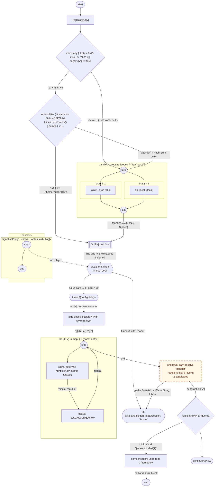

# Odd|Workflow\<T\> \#1 \*beta\* \`v2\`

[All workflows](index.md)

| Property | Value |
|---|---|
| Workflow type | `` Odd\|Workflow<T> #1 *beta* `v2` `` |
| Interface | `` com.example.odd.`Odd Workflow` `` |
| Implementation | ``com.example.odd.`Odd Workflow`.Impl<T>`` |
| Module | `:odd` |
| Commit | `3f786850e387550fdab836ed7e6dc881de23001b` |
| Model mode | gradle |
| Nodes | 22 |
| Unknown nodes | 1 |

## Child workflows

- `Größe|Workflow`: no diagram

## Unknown nodes

- `can't resolve "handler"`: ``handlers[`key`] (event)`` at ``odd/src/main/kotlin/com/example/odd/`Odd Workflow`.kt:23``; candidates: `com.example.B|C`, ``com.example.`odd name`.A``
